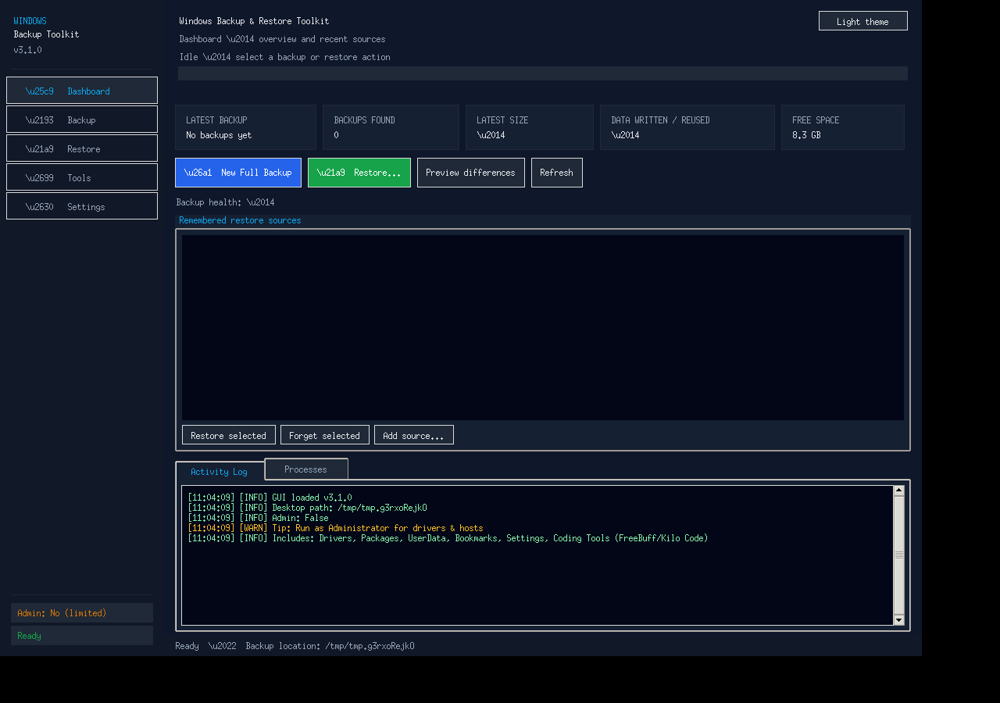
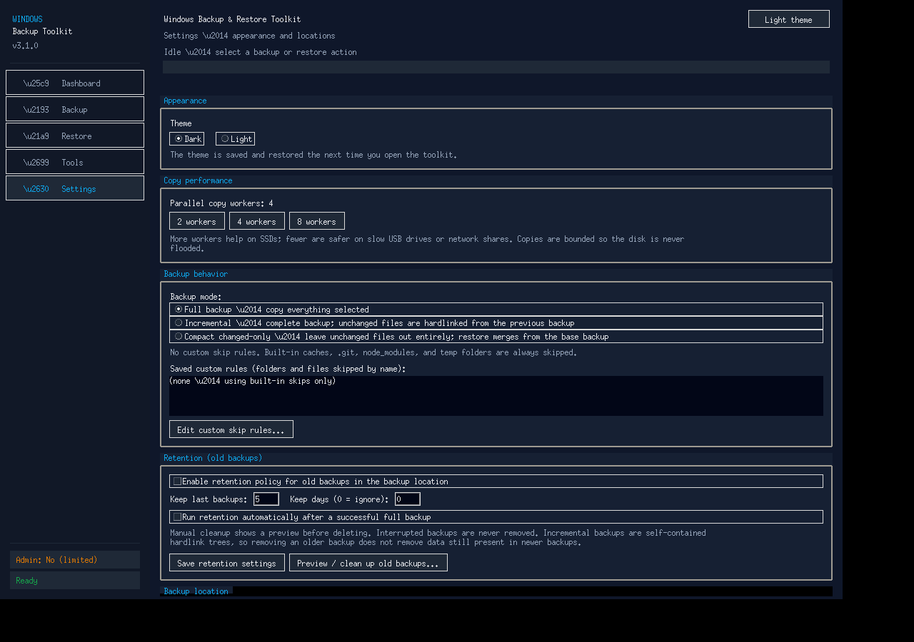

# Backup & Restore Toolkit

[](https://github.com/mohammadhossein-asadi/windows-backup-toolkit/actions/workflows/build-portable.yml)
[](LICENSE)
[](https://github.com/mohammadhossein-asadi/windows-backup-toolkit/releases)

A portable, Windows-only backup and restore app for personal files and key
system settings. It runs as a single-file `tkinter` program with a bundled
Python runtime, so there is nothing to install on the target PC.

> **Platform:** Windows 10/11 (64-bit). The app uses Windows APIs and tools
> (`DISM`, `netsh`, `wmic`/PowerShell fallbacks) for driver and system tasks.

## Features

- **Full, incremental-link, and compact backups** — copy selected folders and
  files, or reuse unchanged data from a previous backup via hard links (NTFS)
  to save space and time. Compact mode lowers RAM/CPU use on slower machines.
- **Integrity sampling** — verify a configurable percentage of copied files by
  hash during backup and restore, catching silent read/write errors early.
- **Resume after interruption** — interrupted runs leave a small marker in the
  output folder; the next run picks up where it left off instead of starting
  over.
- **Smart skip rules & exclusion history** — glob patterns (e.g. `*.tmp`,
  `~$*`, `Thumbs.db`) keep junk out of backups; every exclusion is logged with a
  reason and surfaced in the UI.
- **Retention policy** — keep the last *N* backups or backups from the last *D*
  days, and let the tool clean up older runs automatically.
- **System capture (best effort)** — export third-party drivers, save a report of
  installed programs, and record Wi-Fi profile *names* (password export is an
  explicit opt-in).
- **Real-time dashboard & logs** — progress, ETA, bytes written, current file,
  and a scrollable activity log so you always know what the tool is doing.
- **Portable distribution** — one `.exe` with an embedded Python runtime, custom
  icon and Windows version info. No installer, no admin rights required to run
  (admin is only needed for driver export/restore and some system locations).



## Quick start

### Option A — run the portable exe (recommended)

1. Download the latest `Backup_Restore_Toolkit_*_Portable.exe` (or the `.zip`)
   from the [Releases](https://github.com/mohammadhossein-asadi/windows-backup-toolkit/releases) page.
2. Copy it anywhere you like (Desktop, a USB drive, a tools folder).
3. Double-click it. On first launch it extracts its bundled runtime next to the
   process temp area and opens the toolkit window.
4. Pick a **destination**, choose what to include, and click **Run Backup**. Use
   **Restore** with a previous backup folder to bring files/settings back.

> **SmartScreen note:** unsigned builds may trigger "Windows protected your PC".
> Click *More info → Run anyway* if you trust the source, and verify the release
> checksums (`SHA256SUMS.txt`) before running.

### Option B — run from source (Windows, with Python installed)

```powershell
# Requires Python 3.10+ on Windows (tkinter is included in the standard installer)
python files\Backup_Restore_Toolkit.py
```

`files/Backup_Restore_Toolkit.py` is the canonical source; the portable build
embeds it directly.

## How it works

1. **Scan** — the selected sources are enumerated. Skip rules, symlink/junction
   handling, and an optional exclusion history filter decide what is eligible.
2. **Copy** — files are streamed to the destination. In incremental-link mode,
   unchanged files are hard-linked from the previous backup (same volume/NTFS).
3. **Verify** — a random sample (your chosen percentage) is re-hashed and
   compared to confirm the copy is readable and intact.
4. **Record** — a manifest/summary and a resume marker are written so the run can
   be audited or resumed. Retention prunes old backup folders when enabled.

System items (drivers, installed-programs report, Wi-Fi names) are captured into
dedicated subfolders inside the backup output.



## Building the portable exe

The build is reproducible and runs on Linux (cross-compiling with MinGW-w64).
It downloads a pinned Windows embeddable Python runtime on first run and caches
it under `build/.cache/`.

```bash
# From the repo root (Ubuntu/Debian example)
sudo apt-get update && sudo apt-get install -y mingw-w64 ca-certificates

python3 build/build_portable.py --toolchain /usr --dist-dir dist
```

Outputs land in `dist/`:

- `Backup_Restore_Toolkit_3.1.0_Portable.exe` — single-file launcher
- `Backup_Restore_Toolkit_3.1.0_Portable.zip` — exe + checksums for sharing
- `SHA256SUMS.txt`

See [build/README.md](build/README.md) for cache options, toolchain overrides,
verification flags, and the exact payload layout.

## Project layout

```
files/Backup_Restore_Toolkit.py   # app source (canonical)
build/
  build_portable.py               # one-command reproducible builder
  check_workflow.py               # CI/workflow sanity checks
  launcher/                       # C launcher, resource script, miniz
  assets/                         # app icon (.ico/.png)
  bundle/                         # files embedded alongside the runtime
docs/
  screenshots/                    # UI screenshots used in this README
  HINTS.md                        # operational tips & troubleshooting
.github/workflows/                # CI that builds/releases the portable exe
```

## Configuration & data

- **Settings** are stored as `settings.json` next to the running executable (or
  next to the script when run from source). It remembers your source/destination
  choices and options.
- **Backups** are written to the destination you choose, in timestamped folders
  with a manifest/summary and (when applicable) a resume marker.
- **Logs** are shown in the UI; keep the window open or copy the log if you need
  to report an issue.

## Troubleshooting

| Symptom | What to try |
| --- | --- |
| SmartScreen blocks the exe | Verify `SHA256SUMS.txt`, then *More info → Run anyway*. Prefer official Releases. |
| "Access denied" copying files | Close apps using the files; run the exe as Administrator for protected locations. |
| Driver export/restore fails | Must run elevated; DISM requires Windows Pro/Enterprise features to be present. |
| Hard links not used | Source backup and destination must be on the same NTFS volume; the log will fall back to copying. |
| Restore seems slow or stuck | Large trees and integrity sampling take time; check the dashboard/log for the current file and ETA. |

More detail: [docs/HINTS.md](docs/HINTS.md).

## FAQ

**Is this a replacement for a full disk image?** No. It's aimed at user data and
selected settings. Keep a separate image/OS recovery plan for bare-metal restore.

**Does it upload my data anywhere?** No. Everything stays local to the paths you
select.

**Why is the exe large?** It carries a private Python runtime so the app works on
machines without Python installed.

**Can I back up in-use/locked files?** Best effort. Locked files may be skipped
and reported; close apps or run elevated for better coverage.

## Contributing

Issues and pull requests are welcome — see [CONTRIBUTING.md](CONTRIBUTING.md)
for the dev setup, build, and safety guidelines. Please read the notes about
keeping backups reliable before changing copy/verify/restore logic.

## Changelog

Release notes live in [CHANGELOG.md](CHANGELOG.md).

## License

[MIT](LICENSE).
